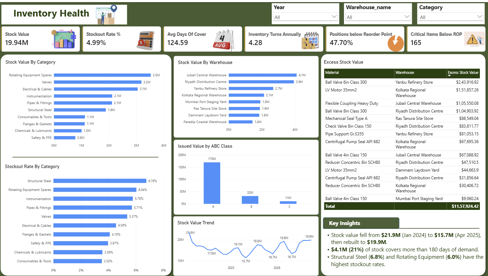
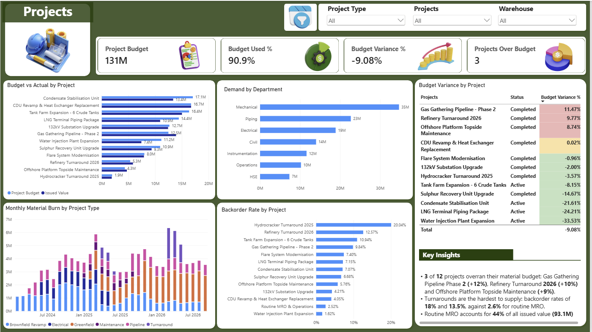
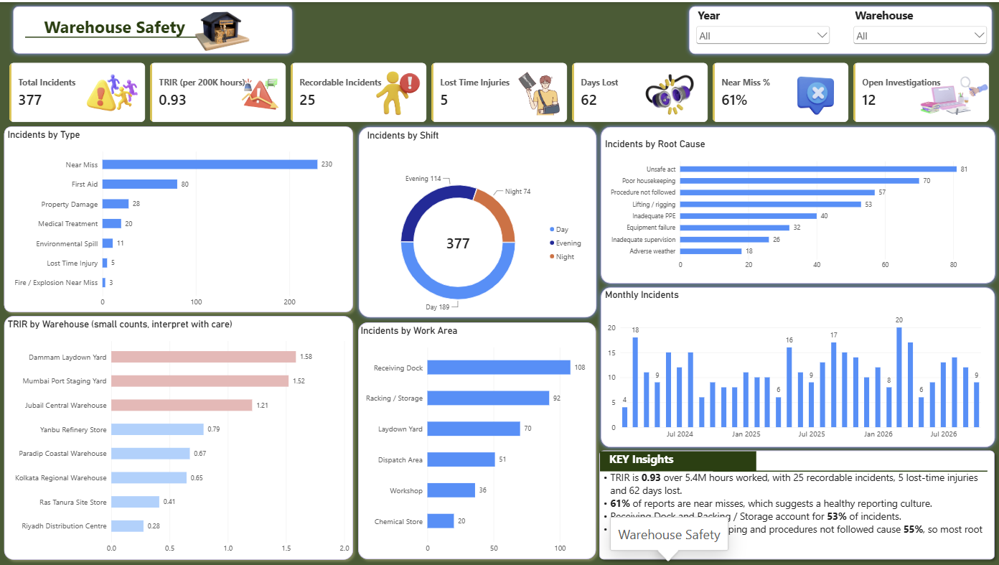

# Oil & Gas Project Materials and Warehouse Logistics Analytics

An end-to-end Power BI project: a synthetic 340K-row, 12-table dataset and a 5-page dashboard covering procurement, warehouse operations, inventory health, project material spend and warehouse safety for a multi-site oil & gas supply chain

# Executive Overview

 

# Procurement & Supplies

 

# Inventory & Health

 

# Projects

 

# Warehouse Safety

# Business problem

Oil & gas projects depend on a steady flow of materials: pipes, valves, instruments, cables, spares and safety equipment. Late deliveries, stockouts, excess stock, budget overruns and unsafe warehouse conditions all cost money and time. This dashboard answers one question across five areas:

Where is the supply chain leaking money, time and safety?

Dashboard pages
#	Page	Question it answers
1	Executive Overview	How is the whole operation performing, and which warehouse needs attention?
2	Procurement	Which suppliers deliver late or reject, and how are prices moving against standard cost?
3	Inventory Health	Is stock the right size? Where are stockouts and excess stock?
4	Projects	Are projects within material budget, and which are hardest to supply?
5	Warehouse Safety	What is the incident rate, where do incidents happen and why?

Screenshots (add your own exports to docs/images/):

Executive Overview Procurement Inventory Health Projects Warehouse Safety

Key findings

Operations

Overall fill rate is 94.45%, but Dammam Laydown Yard lags at 90.58% with a 10.18% stockout rate, double the 4.99% average, and only 56.34% of requests issued on time.
Monthly issued value peaks at 8.7M in March 2026 (the refinery turnaround), against a baseline of about 6M.

Procurement

On-time delivery by supplier tier: Preferred 92.96%, Approved 81.61%, Conditional 59.33%.
Rejection rate by tier: Conditional 13.94% vs Approved 4.80% and Preferred 1.47%, about 3x the Approved rate.
Steel-linked categories (pipes, flanges, structural steel) drift to roughly 1.2 to 1.25 times standard cost by late 2026.
Overdue payables total 15.82M.

Inventory

Stock value fell from 21.9M (Jan 2024) to 15.7M (Apr 2025) and rebuilt to 19.9M.
4.1M (21%) of stock covers more than 180 days of demand (excess stock). Inventory turns are 4.28 a year.
Structural Steel (6.76%) and Rotating Equipment (6.04%) have the highest stockout rates.

Projects

3 of 12 projects overran their material budget: Gas Gathering Pipeline Phase 2 (+11.47%), Refinery Turnaround 2026 (+9.77%) and Offshore Platform Topside Maintenance (+8.74%). Active projects show spend to date against the full budget.
Turnarounds are the hardest to supply: backorder rates of 20.04% (Hydrocracker 2025) and 12.57% (Refinery 2026), against 2.52% for routine MRO.
Routine MRO is 44% of all issued value (93.1M).

Safety

377 incidents over 5.37M hours worked: TRIR 0.93, 25 recordable incidents, 5 lost-time injuries, 62 days lost.
61% of reports are near misses, which points to a healthy reporting culture.
Receiving Dock and Racking / Storage account for 53% of incidents; unsafe acts, poor housekeeping and procedures not followed cause 55%.
Caveat: site-level TRIR rests on 1 to 7 recordable incidents per site, so interpret it with care.
Dataset

12 tables in a star schema (data/), January 2024 to September 2026, in USD.

Table	Rows	Description
dim_date	1,096	Calendar, 2024 to 2026
dim_material	450	Material master: 10 categories, criticality A/B/C, lead time, ABC class
dim_supplier	60	Suppliers: country, tier (Preferred / Approved / Conditional), payment terms
dim_warehouse	8	5 Saudi Arabia and 3 India sites
dim_project	13	12 oil & gas projects plus routine MRO
dim_stock_policy	1,368	Reorder point, order-up-to level and safety stock per material and warehouse
fact_purchase_orders	18,835	PO lines: price, promised vs actual delivery, delay, quality, payment status
fact_material_requests	128,184	Material requests and issues: priority, fulfilled vs backordered, on-time issue
fact_inventory_movements	144,154	Goods receipts, issues, returns and stock adjustments
fact_inventory_snapshot_monthly	45,144	Month-end stock per material and warehouse
fact_hse_incidents	377	Warehouse safety incidents
fact_hse_hours	264	Monthly hours worked and headcount per warehouse

Total: 339,953 rows. See docs/data_dictionary.md for columns and relationships.

How the data is generated

The script (scripts/generate_oilgas_warehouse_dataset.py) runs a day-by-day inventory simulation. Requests arrive with seasonality and project surges. Stock falls, reorder points trigger purchase orders, suppliers deliver early or late depending on tier, and receipts, rejections and stock levels all follow from that. Because the tables come from one simulation, they reconcile with each other.

Patterns built in on purpose:

Conditional suppliers are less reliable, reject more, and charge less.
Dammam holds the leanest safety stock, so it has the highest stockout rate.
Turnaround projects create demand spikes and the highest backorder rates.
Steel-linked categories inflate faster than other categories.
To regenerate the data:

bash
pip install -r requirements.txt
python scripts/generate_oilgas_warehouse_dataset.py

The seed is fixed (42), so the output is reproducible.

Data model

Dimension tables filter the fact tables (many-to-one, single direction):

Material → purchase orders, material requests, movements, snapshots and stock policy (material_id)
Warehouse → all fact tables and stock policy (warehouse_id)
Project → purchase orders, material requests and movements (project_id)
Supplier → purchase orders (supplier_id)
Date_set → one date column per fact table: po_date, request_date, movement_date, snapshot_date, incident_date, and month_end_date for hours worked

22 relationships in total. Supplier is not linked to the date table. Full details are in docs/data_model.md.

Measures

Core DAX measures (full list in docs/dax_measures.md):

Area	Measures
Procurement	Total PO Value, OTD %, Rejection Rate %, Avg Delay (Late POs), Overdue Payables, Price vs Std Cost
Operations	Fill Rate %, Backorder Rate %, On-Time Issue %, Issued Value YoY %
Inventory	Stock Value, Stockout Rate %, Days of Cover, Inventory Turns, Excess Stock %, Critical Items Below ROP
Projects	Project Budget, Budget Used %, Budget Variance %, Projects Over Budget
Safety	Total Incidents, TRIR, Lost Time Injuries, Days Lost, Near Miss %
Tools and skills
Power BI Desktop: data model, DAX, conditional formatting, page navigation
Power Query: data typing and shaping
DAX: KPIs, time intelligence, row-context measures
Python (pandas, numpy): synthetic data simulation
Repository structure
oil-gas-warehouse-analytics/
├── README.md
├── LICENSE
├── requirements.txt
├── data/                     # 12 CSV tables
├── scripts/
│   └── generate_oilgas_warehouse_dataset.py
├── docs/
│   ├── data_dictionary.md
│   ├── data_model.md
│   ├── dax_measures.md
│   └── images/               # dashboard screenshots
└── powerbi/                  # place the .pbix file here
How to use
Clone the repo.
Open Power BI Desktop and choose Get data > Text/CSV, then load the files in data/.
Build the relationships from docs/data_model.md, mark dim_date as the date table, and add the measures from docs/dax_measures.md.
Author

Imran Khan, Data Analyst LinkedIn · GitHub

Licensed under the MIT License.
